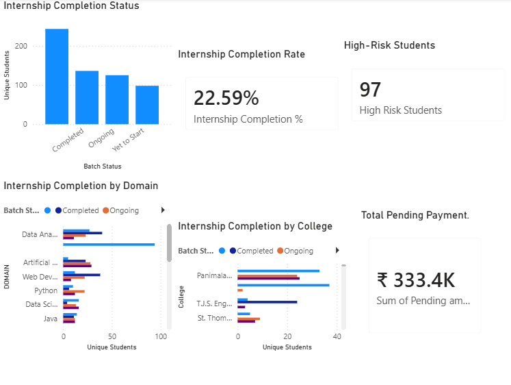
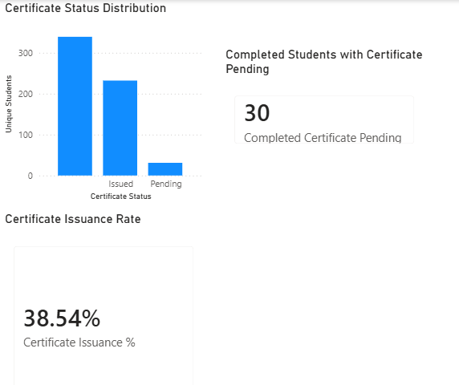

# Student Payment Data Cleaning and Analysis

## Project Overview

This project focuses on cleaning, transforming and analysing student registration, internship and payment data using Python, Pandas and Power BI.

The objective is to improve data quality and provide useful insights to support management decisions, student registration monitoring, batch planning, internship performance tracking, certificate management and payment follow-up.

## Tools and Technologies

- Python
- Pandas
- Jupyter Notebook
- Microsoft Power BI
- Microsoft Excel

## Project Activities

- Data cleaning and standardisation
- Missing-value and duplicate checks
- Integration of student registration, internship, course and payment data
- Payment collection and pending-payment analysis
- Student registration analysis
- Batch and staff planning
- Internship performance monitoring
- Certificate management
- Management reporting and decision support

## Power BI Dashboard

The following screenshots showcase selected reports developed for the project.

### 1. Management Overview

### 2. Student Registration Analysis

### 3. Batch and Staff Planning

### 4. Internship Performance

### 5. Certificate Management

### 6. Management Decisions

## Data Privacy

The original dataset contains student-related and financial information. The original Power BI file and confidential student-level records are not included in this public portfolio.

Screenshots should be published only after confirming that the information shown is authorised for public sharing.

## Project Outcome

This project demonstrates practical skills in data preparation, data quality checks, data integration, analytical reporting and dashboard development to support operational and management decisions.
